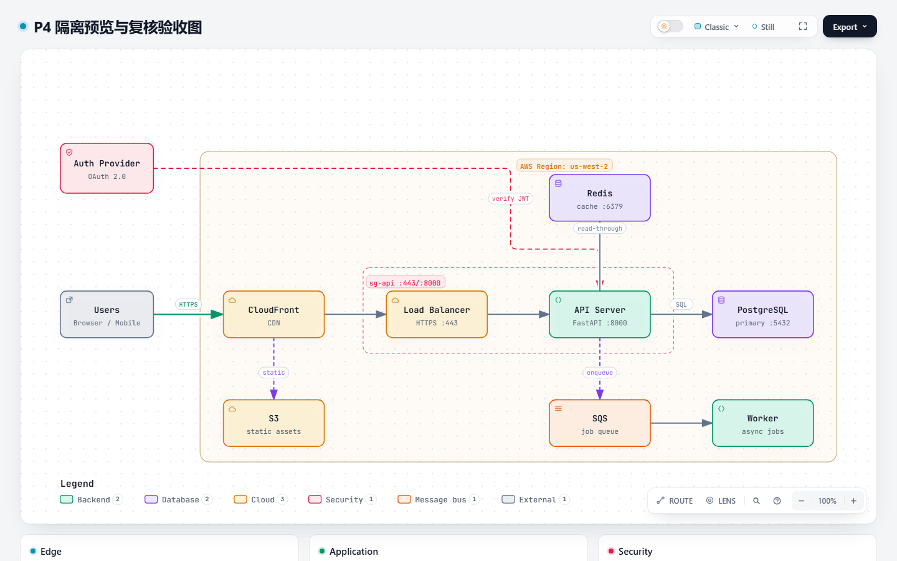

# P4：隔离预览、视觉复核与导出验收

> 状态：**已落地**（`feature/archify-p0`）。范围只包括 WPF / WebView2 宿主；
> MAUI 与其他宿主继续走“用浏览器打开”。

## 1. 结论

- Archify 产物现在可以在应用内预览：先把 `.archify/...` 复制到
  `<DataRoot>/preview/<token>/`，再通过 WebView2 虚拟主机
  `https://archify-preview.local/` 加载；工作区原件不改动。
- Blazor 只渲染 `iframe sandbox="allow-scripts allow-downloads"`；**没有**
  `allow-same-origin`、`allow-top-navigation`，HTML 不进入 Markdown / 聊天 DOM。
- 暂存副本注入 CSP：`default-src 'none'`，只允许内联脚本 / 样式、`data:` /
  `blob:` 图片与媒体；外部网络、frame、worker、导航、object、form 一律禁止。
- 视觉复核必须由用户点击“视觉复核”触发；运行
  `visual-check --summary --require-provenance`，截图与联系表落在
  `.archify/<...>/visual-check/`。结果如实保留 `visualReview=pending`，
  自动截图不等于人工复核。
- 导出走 Archify 自带 Export 菜单；WebView2 `DownloadStarting` 只接受
  PNG / JPEG / WebP / SVG / WebM，统一保存到 `<DataRoot>/preview/exports/`。

## 2. 实现

| 层 | 文件 | 作用 |
| --- | --- | --- |
| Contracts | `IArtifactPreviewService.cs` | 预览 host / 结果契约 |
| Contracts | `IArchifyReviewService.cs` | 截图、联系表、复核结果契约 |
| Core | `ArtifactPreviewService.cs` | 复制暂存、大小/文件数上限、CSP 注入、URI 生成 |
| Core | `ArtifactExportPolicy.cs` | 导出扩展名、文件名清洗、重名时间戳、目录约束 |
| Core | `ArchifyReviewService.cs` | 解析 `visual-check` JSON、直跑策略、审计 |
| Core | `UnavailableArtifactPreviewHost.cs` | 非 WPF 宿主兜底 |
| WPF | `WebView2ArtifactPreviewHost.cs` | 虚拟主机映射、下载拦截、exports 目录 |
| WPF | `MainWindow.xaml.cs` | WebView2 初始化后挂载 host |
| UI | `ArtifactLinks.razor` | “应用内预览”入口 |
| UI | `ArtifactPreviewPanel.razor` | iframe、复核、截图、导出、关闭 |
| UI | `app.css` | 覆盖层、iframe、复核面板样式 |

DI 顺序：WPF `App.xaml.cs` 先注册 `WebView2ArtifactPreviewHost` 与
`IArtifactPreviewHost`，再调用 `AddDesktopAgentCore()`，覆盖 Core 的
`UnavailableArtifactPreviewHost`。

## 3. 边界与失败路径

- 预览只接受工作区下 `.archify/` 内的 `.html`；绝对路径、`..`、盘符路径拒绝。
- 单 HTML 上限 50 MB、单目录 64 MB / 2000 个文件；重解析点（symlink / junction）
  跳过，避免复制出界。
- 暂存使用 GUID token 目录；原始产物哈希单独返回用于展示，不复写原件。
- 已自带 CSP 的产物不重复注入；没有 `<head>` 时在 `<html>` 后补一个。
- 复核仍受 P2 的直跑开关、`node` 白名单、argv 与 cwd 约束；审计记录
  `archify_visual_check`、脚本哈希、命令哈希、退出码、耗时。
- `visual-check` 返回 `ok=false` 或非 JSON 时给可恢复失败信息；`visualReview`
  只会显示脚本返回值，不会由 UI 擅自改写成“已人工复核”。
- 非 Windows / WebView2 未挂载时，`IsSupported=false`，预览按钮不出现；
  浏览器打开按钮保持可用。
- WebView2 的 `DownloadStarting` 是应用级事件；当前只放行上述扩展名并落到
  exports，其他下载直接取消。若后续出现非预览导出需求，应改成按会话/来源白名单。

## 4. 真实验收

真实产物由已安装的 Archify 3.2.0 重新 `finalize` 生成，带 delivery provenance：

- 路径：`.archify/architecture-p4/p4.html`
- 大小：**846,254 B**
- sha256：`55a4abfd1e3744651f40c54f79b470d9907de1aa4e4175e25b7eea122bacc4f4`
- `visual-check`：`ok=true`、`status=pass`、`visualReview=pending`、
  `provenance=current`
- 检查项：`containment/readability/viewerChrome/themeStates/captures` 全部 `pass`
- 证据：4 张截图（1440×900 / 2048×1320，浅色 + 深色）、联系表 HTML、
  receipt JSON；位置 `.archify/architecture-p4/visual-check/`

`tools/p4-archify` 探针同时验证：

1. 暂存副本含 `Content-Security-Policy`，且预览 URI 的 host 是隔离源；
2. 真实 Edge 跑出 4 张截图与联系表；
3. 审计恰好 1 条，脚本哈希与安装包一致；
4. 报告写入 `.archify/architecture-p4/p4-probe-report.json`。

命令：

```powershell
dotnet run --project tools/p4-archify -c Release -- `
  --skills-root .tmp/p3-skills `
  --workspace .tmp/p3-workspace `
  --artifact .archify/architecture-p4/p4.html `
  --staging .tmp/p4-preview
```

输出摘要：

```text
预览源：https://archify-preview.test/1ec14f82f9e24f1aa27c4d2bd323c118/p4.html
暂存：...\.tmp\p4-preview\1ec14f82...（CSP True）
复核：pass / visualReview=pending / 截图 4 张
审计：1 条；脚本 sha256:3cebcee3...
P4 预览与复核检查通过。
```

> 探针里的 host 用 `archify-preview.test` 只是为了避免在控制台进程里启动
> WebView2；真实 WPF host 用 `archify-preview.local` + `DenyCors` 映射。
> `WebView2ArtifactPreviewHost` 的 DI 挂载已通过 WPF 构建，运行时点击验证
> 需要手动打开桌面窗口。

### 4.1 Sandbox + CSP 实测

把暂存 HTML 放进只给 `allow-scripts allow-downloads` 的 iframe，用本机 Edge
加载并截图；产物正常渲染、主题 / Export 工具条可见，说明内联脚本仍被 CSP
放行、没有依赖同源能力：




## 5. 测试

```powershell
dotnet test tests/SDemo.DesktopAgent.Core.Tests -c Release
dotnet test tests/SDemo.DesktopAgent.UI.Tests -c Release
dotnet test tests/SDemo.DesktopAgent.Sandbox.Tests -c Release
dotnet build SDemo.DesktopAgent.slnx -c Release
```

P4 新增覆盖：

- `ArtifactPreviewServiceTests`：CSP 注入、原件不变、同目录引用复制、
  已有 CSP 不重复、越界路径 / 非 `.archify` 拒绝、无 host 回退。
- `ArtifactExportPolicyTests`：允许扩展名、拒绝可执行 / 脚本、去目录、
  重名时间戳、导出目录约束。
- `ArchifyReviewServiceTests`：真实参数、直跑关闭拒绝、越界拒绝、非 JSON
  失败、审计字段与 `visualReview=pending`。
- `ArtifactPreviewPanelTests`：iframe sandbox 不含 `allow-same-origin`、
  不内联 HTML、复核 pending 与截图入口、浏览器打开、导出目录。
- `ArtifactLinksTests`：预览按钮打开面板、浏览器回退。

最终结果：Core **945** 通过；UI **146** 通过；Sandbox **219** 通过、**1** 跳过
（AppContainer 删除变更用例按既有平台条件跳过）；`SDemo.DesktopAgent.sln`
Release 构建成功（仅 `tools/p1-baseline` 两条既有 CA1416 警告）。

## 6. 限制

- 仅 WPF / WebView2；MAUI 不提供应用内预览，按钮隐藏并回退浏览器。
- CSP 会拦截外部网络请求。Archify 产物是自包含 HTML，实测通过；若未来
  上游引入 CDN 字体 / 外链图片，需要先显式扩展 CSP 并在报告中说明。
- 应用内预览的截图只由 `visual-check` 的 Edge 进程生成，不是 WebView2 截图；
  两者使用同一份暂存 HTML 和同一 CSP。
- 本次自动验收没有启动 WPF 窗口做鼠标点击；虚拟主机映射与 DownloadStarting
  为 WebView2 运行时行为，已通过编译和单元测试，仍需在桌面端做一次人工冒烟。
- 预览暂存目录目前不自动清理；由 `<DataRoot>/preview` 随应用数据目录管理。
